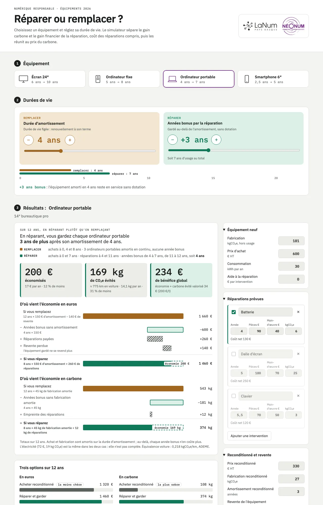

# Réparer ou remplacer ?


[](LICENSE)

**[Ouvrir le simulateur en ligne](https://gridboy.github.io/simulateur-reparer-remplacer/)**



Vous hésitez entre remplacer un équipement numérique et le réparer ? Ce simulateur chiffre les deux options en euros et en kgCO₂e, pour un écran 24″, un ordinateur fixe, un ordinateur portable ou un smartphone 6″ de 2026.

Vous réglez la durée de vie, les réparations et leur coût. L'outil calcule ce que vous gagnez ou perdez en gardant l'équipement plus longtemps. Il ne fait pas l'inventaire d'un parc.

LaNum Pays Basque et NéoNum portent le projet.

## Pourquoi simuler avant de remplacer

Face à une panne, vous comparez en général le devis de réparation au prix du modèle neuf. Cette comparaison laisse de côté le carbone de fabrication et la durée d'usage.

**Vous payez l'essentiel du carbone à l'achat.** Pour un portable, un smartphone ou un écran, la fabrication pèse plus que l'électricité consommée pendant toute la vie de l'appareil, en particulier en France où le kWh émet 0,052 kgCO₂e. Chaque remplacement anticipé vous fait payer une nouvelle fabrication. En gardant l'appareil plus longtemps, vous répartissez cette fabrication sur plus d'années.

**Vous payez un équipement par année de service.** Votre service comptable amortit un portable en 3 ans. Si vous le gardez 7 ans, chaque année d'usage vous coûte 182 € au lieu de 281 € avec un remplacement tous les 4 ans. Une batterie à 130 € vous paraît chère face à un devis ; ramenée aux 3 années qu'elle ajoute, elle vous fait économiser.

**Vos deux gains peuvent diverger.** Une réparation peut vous laisser à l'équilibre en euros et vous faire gagner en carbone. Une pièce lourde à produire peut produire l'effet inverse. Le simulateur affiche les deux gains côte à côte, puis les additionne en valorisant le carbone au prix que vous choisissez.

Pour chaque équipement, vous obtenez le budget de réparation et l'empreinte de pièces au-delà desquels remplacer redevient préférable.

### Exemple : ordinateur portable pro

Avec les hypothèses par défaut : portable à 1 100 € HT, 181 kgCO₂e de fabrication, remplacé tous les 4 ans, ou gardé 7 ans avec un changement de batterie à 130 €.

| | Remplacer (4 ans) | Réparer (7 ans) |
|---|---|---|
| Empreinte par an | 46,8 kgCO₂e | 28,3 kgCO₂e |
| Coût par an | 281 € | 182 € |

Sur 12 ans, vous évitez 222 kgCO₂e et 1 191 € de dépenses en réparant. Vos réparations restent rentables jusqu'à 825 € d'interventions cumulées.

## Fonctions

- **Durées de vie** : vous réglez la durée habituelle (remplacer), puis les années gagnées par la réparation, de +0 à +10 ans, avec boutons et curseur.
- **Réparations** : vous fixez pour chaque intervention son année, ses pièces, sa main-d'œuvre et son empreinte carbone. Vous pouvez déduire une aide à la réparation.
- **Ce que vous économisez** : le simulateur répond en une phrase (combien d'équipements vous achetez dans chaque cas), puis en trois chiffres sur l'horizon choisi : euros économisés, kgCO₂e évités avec leur équivalent en kilomètres de voiture, et bénéfice global au prix du carbone choisi.
- **D'où vient l'économie** : un pont de calcul par dimension part du total « si vous remplacez », retire les achats ou la fabrication évités, ajoute les réparations et arrive au total « si vous réparez ». L'écart apparaît en pointillés.
- **Calendrier des dépenses** : les courbes cumulées montrent quand vous payez, avec une marche à chaque achat ou réparation.
- **Seuils de pertinence** : budget et empreinte de réparation au-delà desquels remplacer devient préférable.
- **Amortissement comptable** : la frise distingue les années d'amortissement des années où l'équipement amorti reste en service.
- **Comparaison** des quatre équipements et d'un poste de travail complet.

## Modèle de calcul

- Empreinte annuelle = (fabrication + réparations) ÷ durée de vie + consommation × mix électrique
- Coût annuel = (prix d'achat + pièces + main-d'œuvre − aide) ÷ durée de vie + consommation × prix de l'électricité
- Gain net sur l'horizon = (bilan « remplacer » − bilan « réparer ») × horizon
- Seuil de pertinence = prix neuf (ou empreinte de fabrication) × (durée prolongée ÷ durée habituelle − 1)

Le modèle applique la même consommation électrique aux deux scénarios.

## Sources et limites

- Empreinte de fabrication : [ADEME Base Empreinte](https://base-empreinte.ademe.fr/) (données NegaOctet), reprises par l'[API Boavizta](https://github.com/Boavizta/boaviztapi). Portable pro 181, ordinateur fixe 277 (unité centrale seule), écran 64,7 et smartphone 84 kgCO₂e.
- Mix électrique France : 0,052 kgCO₂e/kWh (ADEME).
- Équivalence voiture : 0,218 kgCO₂e/km, voiture thermique moyenne (ADEME, Impact CO2).
- Prix du carbone : valeur de l'action pour le climat (rapport Quinet, 2019), environ 200 €/t en 2026 et 250 €/t en 2030.
- Les prix 2026, les consommations et l'empreinte des pièces détachées restent des ordres de grandeur. Remplacez-les par vos devis, fiches produits ou données d'inventaire.
- Les facteurs ADEME décrivent des équipements de référence antérieurs à 2026.
- Outil voisin : [Boavizta Terminal Impact](https://dataviz.boavizta.org/terminalimpact).

## Lancer en local

```sh
npm start        # http://localhost:8080 (serveur statique Python)
npm test         # tests du moteur de calcul (Node ≥ 18)
npm run bump     # nouveau numéro de version (?v=…) avant chaque livraison
```

Avant de pousser une nouvelle version, lancez `npm run bump` : le script change le numéro `?v=` de toutes les ressources, pour que les navigateurs ne mélangent pas fichiers en cache et fichiers neufs.

L'application tourne sans dépendance ni build. Elle charge des modules ES : servez-la en HTTP, car le navigateur bloque leur chargement en `file://`. Un hébergement statique comme GitHub Pages suffit.

Votre navigateur garde vos réglages (localStorage). L'application n'envoie rien à un serveur.

## Structure

```
index.html              page et structure des sections
styles/tokens.css       jetons de design (couleurs, polices, thèmes clair/sombre)
styles/app.css          styles des composants
src/main.js             point d'entrée : store et montage des vues
src/data/defaults.js    hypothèses par défaut (ADEME / Boavizta, prix 2026)
src/core/calc.js        moteur de calcul, fonctions pures
src/core/format.js      formatage fr-FR
src/state/store.js      état, abonnements, persistance locale
src/ui/*.js             une vue par fichier (sélecteur, durées, bilans, courbes…)
assets/logos/           logos partenaires (LaNum, NéoNum)
tests/calc.test.js      tests du moteur
scripts/bump-version.mjs  numéro de version des ressources (cache navigateur)
docs/capture.webp       capture d'écran du README
```

## Sobriété

L'application applique l'éco-conception qu'elle défend : 2 familles de polices (4 variantes), aucun framework, moins de 20 Ko de logos. Votre navigateur génère les graphiques en SVG et fait tous les calculs.

## Licence

Ce simulateur est publié sous [licence publique de l'Union européenne EUPL-1.2](LICENSE). Vous pouvez l'utiliser, le modifier et le redistribuer, y compris à des fins commerciales. Si vous distribuez une version modifiée ou la proposez en service en ligne, vous devez publier son code source sous EUPL-1.2 ou sous une licence compatible listée dans l'annexe de la licence.

L'EUPL a la même valeur juridique dans les 23 langues officielles de l'Union, dont le [texte en français](https://joinup.ec.europa.eu/collection/eupl/eupl-text-eupl-12).

Les logos LaNum Pays Basque et NéoNum appartiennent à leurs organisations et ne relèvent pas de cette licence.
